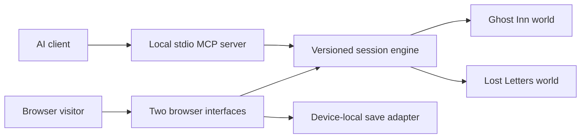

# Architecture

## Authority
The engine is the sole owner of each committed session. It passes a cloned draft to an explicit world action.
It validates the resulting state and constructs the public projection **before** committing the next version.
Both action and observation inputs are isolated from internal references.
Reserved session metadata always comes from the engine.

A world owns its rules and public knowledge. Ghost Inn checks location, discoveries, inventory, puzzle progress, and final delivery.
It exposes clue text only after discovery. Its save validator rejects contradictory flags, duplicated items, invented clue text, and mismatched endings.
Lost Letters owns the brief, authored composition, manual drafts, bounded undo history, tone and seal state.

## Failure and concurrency
A missing, invalid or stale expectedVersion is rejected before an action mutates any committed state.
Two browser tabs can each hold a separate in-memory view; localStorage is a local persistence mechanism, not a multi-user synchronization service.
The browser client checks for external save changes before each write, import or reset and asks the user to reload. This is a best-effort stale-tab guard, not an atomic multi-tab synchronization protocol.

MCP processes have separate session stores. A save ID cannot replace an existing session through restore.
Saves contain user text. Their validators check structure and world invariants, not cryptographic provenance.
Anyone with the device or exported file may read that text.

## Rendering and deployment
Application text is inserted through textContent, text nodes, form values and DOM creation.
The only innerHTML insertion is a fixed developer-authored SVG/image scene, selected from the known room ID; no user text reaches it.
The static build includes only site assets, the shared core and the two world modules. MCP dependencies and server code are not served.
A host that supports the included _headers file receives a restrictive content security policy.

## Extension boundaries
Add a world descriptor instead of extending the engine with story-specific branches.
A live model should propose narration or choose an available action; it does not directly mutate world state.
No model call is required for either browser experience. The wording on the site and in the contest materials keeps that distinction explicit.

